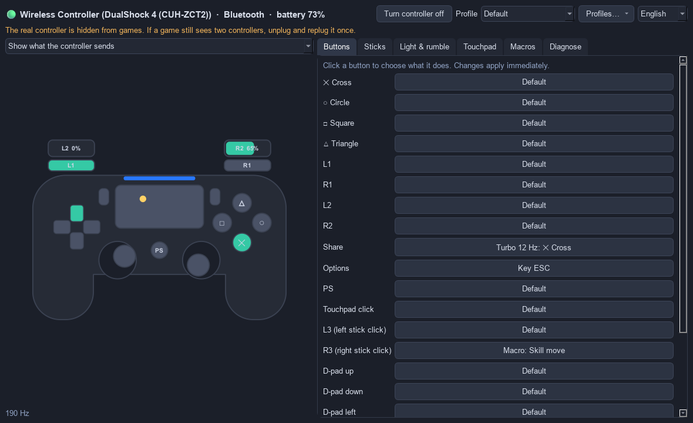
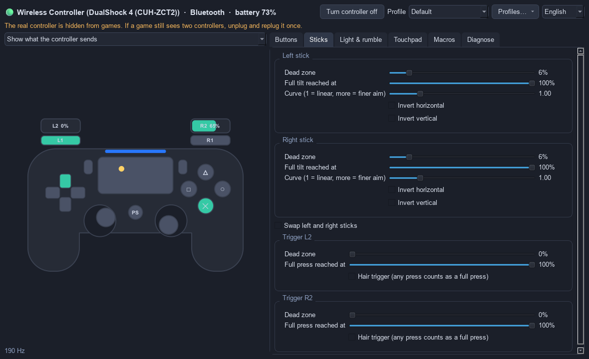
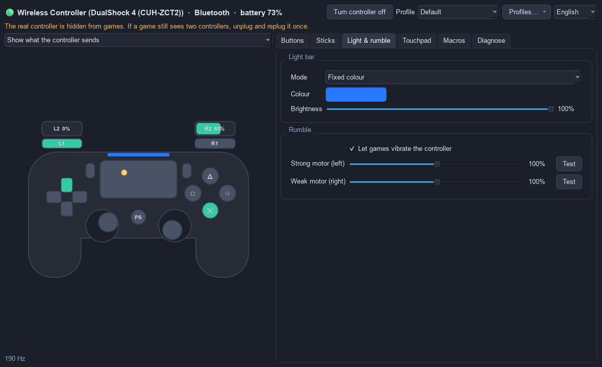
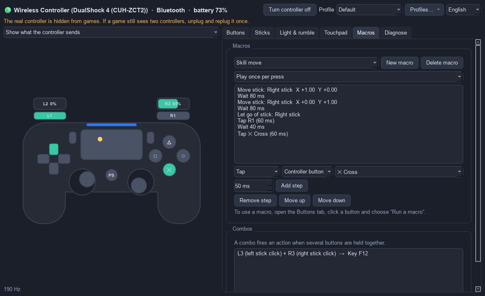
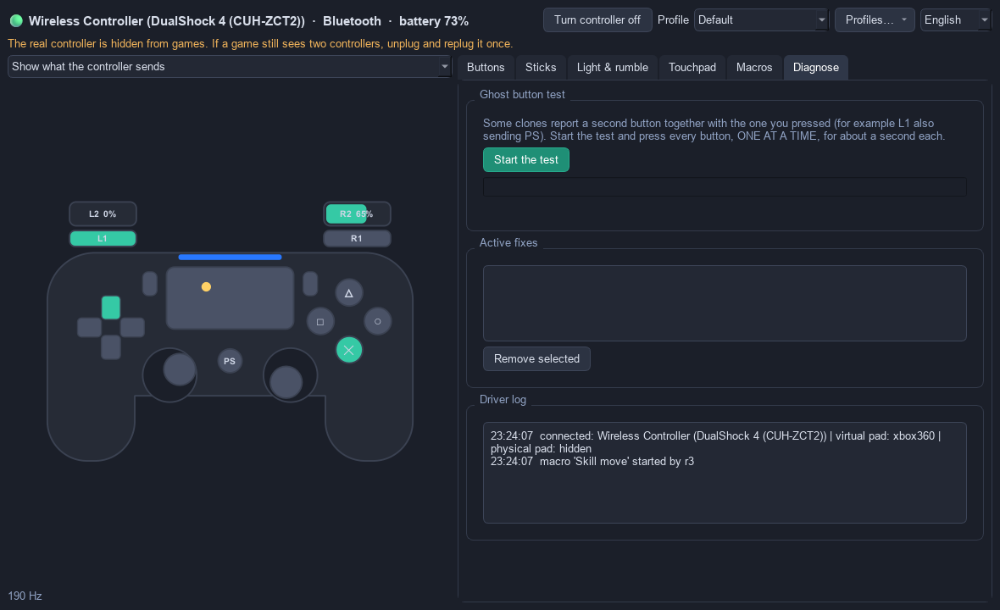

# GambiPad

**Open-source driver and configurator for DualShock 4 style controllers and their clones.**
Windows and Linux. No vendor software.

[Português (Brasil)](README.pt-BR.md)



> *Gambiarra* (Brazilian Portuguese): a clever fix that makes something work when it
> really should not. That is what this project does for cheap controllers.

## Why

Generic "PS4" controllers copy Sony's USB identity but not always Sony's firmware.
The pad this project was born from sends the **PS** button every time **L1** is
pressed, and the **touchpad click** every time **R1** is pressed. In a game this
means screenshots, magnifiers and overlays firing by themselves, because Steam and
Windows believe you are holding PS.

GambiPad sits between the controller and your games:

```
real controller ──HID──▶ GambiPad ──▶ clean virtual controller ──▶ games
                          │  ghost-button filter, remaps, macros
                          └─▶ light bar and rumble back to the pad
```

The real controller is hidden from games, so they only see the corrected one.

## Features

- **Ghost button test and fix** - press each button once, GambiPad finds the ones
  that drag a second signal along and filters it out.
- **Defective firmware detection** - warns when a controller corrupts its own
  reports (the clone above repeats every fourth byte, losing the right stick's
  horizontal axis) and disables the inputs that cannot be trusted.
- **Remap** every button to another button, keyboard keys or mouse buttons.
- **Turbo**, **toggle**, **combos** (several buttons held together fire an action).
- **Macros** - sequences of presses, stick movements and pauses, played once, while held, or toggled.
- **Turn the controller off** from the window or the tray (Bluetooth).
- **Sticks**: dead zone, outer limit, response curve, invert, swap.
  **Triggers**: dead zone, range, hair trigger.
- **Light bar**: fixed colour, battery level, rainbow, off.
- **Rumble**: game vibration is forwarded to the pad, with per-motor strength.
- **Touchpad**: pass through, mouse pointer, or two extra buttons.
- **Profiles** you can import, export and share (plain JSON).
- Live view of what the controller sends and what the game receives.
- English and Portuguese interface.

## Screenshots

| Sticks and triggers | Light bar and rumble |
|---|---|
|  |  |

| Macros and combos | Ghost button test |
|---|---|
|  |  |

The pictures show the real window fed by a simulated controller.

## Status

Version 0.1 - young software. What has actually been tested:

| | Status |
|---|---|
| Windows 11, USB and Bluetooth, clone `054C:09CC` | Tested on real hardware |
| Reading buttons, sticks, triggers, battery | Tested |
| Ghost button detection and filtering | Tested |
| Virtual Xbox 360 controller (ViGEmBus) | Tested |
| Hiding the real pad (HidHide) | Tested |
| Rumble and light bar output over USB | Tested |
| Virtual DualShock 4 controller | Written, lightly tested |
| Bluetooth: reading, hiding the real pad, switching it off | Tested |
| Bluetooth: light bar and rumble output | Written, **not confirmed** |
| Linux (uinput) | Installer tested automatically; driver **not tested on hardware yet** |

Reports from other controllers and from Linux are very welcome - open an issue.

## Install

### Windows

Download **GambiPad-Setup** from the [latest release](https://github.com/agentkyo/gambipad/releases/latest)
and run it. It installs for your user only, with no administrator prompt, and can
start GambiPad with Windows. Two drivers are needed, and the installer offers to
open their download pages when they are missing:

- [ViGEmBus](https://github.com/nefarius/ViGEmBus/releases/latest) creates the virtual controller.
- [HidHide](https://github.com/nefarius/HidHide/releases/latest) hides the real one from games (reboot after installing it).

The executable is not code-signed, so SmartScreen asks for confirmation the first
time ("More info", then "Run anyway"). A portable zip is published next to the installer.

### Linux

```
curl -fsSL https://raw.githubusercontent.com/agentkyo/gambipad/main/install.sh | bash
```

| Distribution | How the installer handles it |
|---|---|
| Arch, **CachyOS** | `pacman` for the build tools and Qt libraries |
| **Ubuntu**, **Zorin OS**, Debian | `apt` |
| **Fedora** | `dnf` |
| **Bazzite**, Silverblue, Kinoite | image-based: nothing is layered, prebuilt Python packages are used |

GambiPad goes into a private Python environment under `~/.local/share/gambipad`,
with a menu entry and the `gambipad` command in `~/.local/bin`. The only step that
needs your password is the udev rule that gives your user access to the controller
(hidraw) and to `/dev/uinput`. Options: `--autostart` (start with your session),
`--no-system` (never ask for a password), `--uninstall`.

The installer is run from scratch on Ubuntu, Fedora and Arch images on every change.
GambiPad itself has not been used with a controller on Linux yet.

### With pip (any system, Python 3.11+)

```
pip install git+https://github.com/agentkyo/gambipad
gambipad
```

On Windows, pip may open the ViGEmBus installer while installing the `vgamepad` dependency.
## Use

`gambipad` opens the window. It keeps running in the system tray when closed.

1. Plug the controller in.
2. Open **Diagnose → Start the test** and press each button, one at a time.
3. If ghost buttons are found, click **Apply the fix**.
4. Unplug and replug the controller once, so programs that were already reading
   the real pad (Steam, for instance) let go of it.

Command line:

| Command | What it does |
|---|---|
| `gambipad` | open the window |
| `gambipad run` | run the driver with no window |
| `gambipad devices` | list supported controllers |
| `gambipad monitor` | print what the controller reports |
| `gambipad diagnose --apply` | find ghost buttons and save the fix |
| `gambipad rumble` | test both motors |
| `gambipad off` | switch a Bluetooth controller off |
| `gambipad doctor` | check the system requirements |

Profiles live in `%APPDATA%\GambiPad\profiles` (Windows) or
`~/.config/gambipad/profiles` (Linux). The format is described in
[docs/PROFILE.md](docs/PROFILE.md).

## Good to know

- **Is this a kernel driver?** No. It is a user-space driver: it reads the pad over
  HID and creates the virtual controller through ViGEmBus (Windows) or uinput
  (Linux). Nothing unsigned is loaded into the kernel.
- **Steam**: with the fix active, the virtual pad never sends a phantom PS press,
  so Steam's guide-button shortcuts stop firing. No Steam setting needs changing.
- **A game sees two controllers**: replug the pad once after GambiPad started.
- **My controller is not detected**: run `gambipad devices`. Pads that do not use
  Sony's IDs can be added in `settings.json` as `"extra_devices": [[vendor, product]]`
  (decimal numbers) if they speak the DualShock 4 protocol.
- **Macros and online games**: automated input may break the rules of competitive
  games. Using them there is your responsibility.

## Develop

```
git clone https://github.com/agentkyo/gambipad
cd gambipad
python -m venv .venv
.venv/Scripts/pip install -e .[dev]     # Linux: .venv/bin/pip
.venv/Scripts/python -m pytest
```

The protocol (`ds4.py`) and the mapping engine (`engine.py`) are pure Python with
no hardware access, so the tests run anywhere.

## Credits

Built on [hidapi](https://github.com/libusb/hidapi),
[ViGEmBus](https://github.com/nefarius/ViGEmBus) and
[HidHide](https://github.com/nefarius/HidHide) by Nefarius,
[vgamepad](https://github.com/yannbouteiller/vgamepad),
[python-evdev](https://github.com/gvalkov/python-evdev) and
[Qt for Python](https://doc.qt.io/qtforpython/).
Not affiliated with Sony. "DualShock" and "PlayStation" are trademarks of Sony
Interactive Entertainment.

## License

[MIT](LICENSE)
