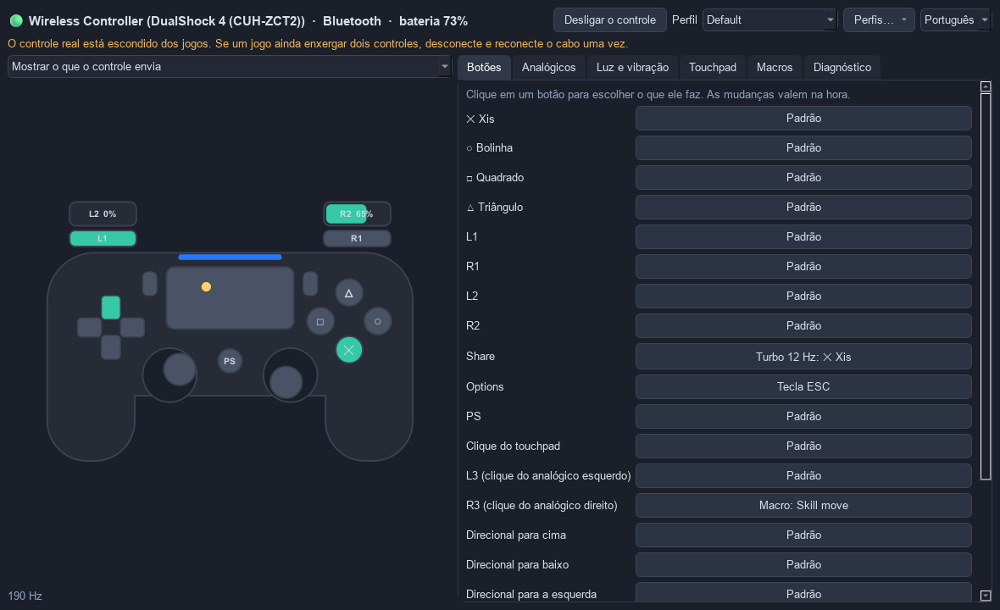
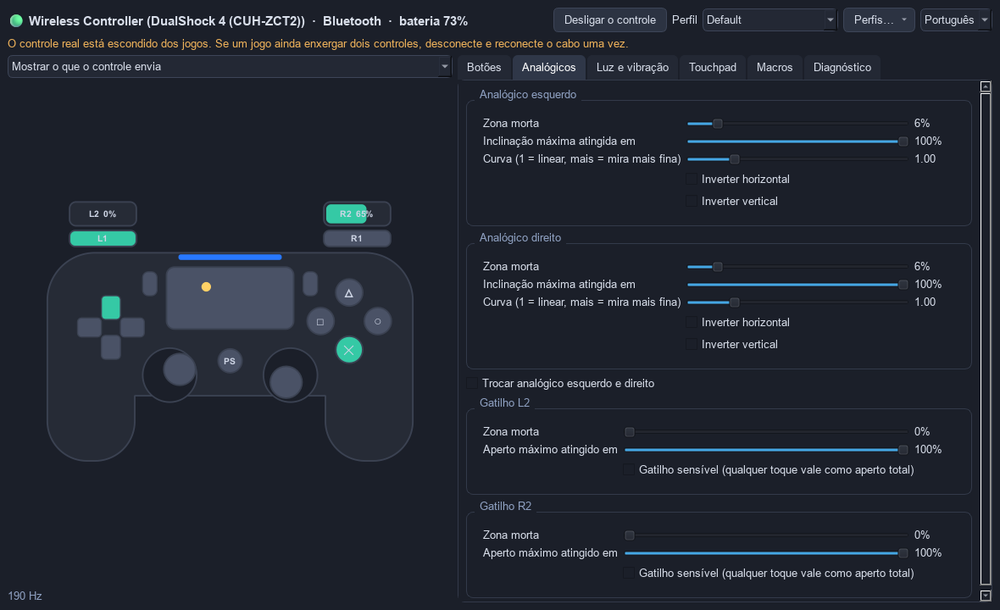
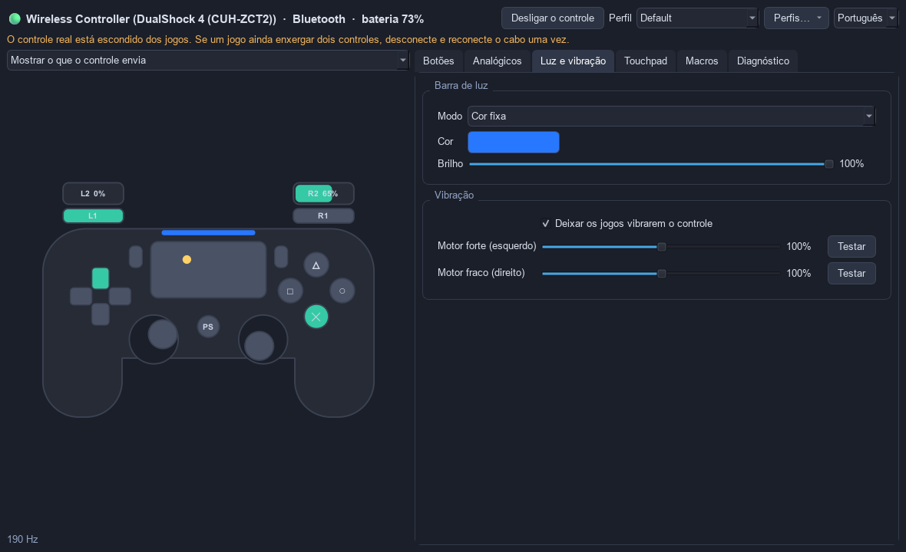
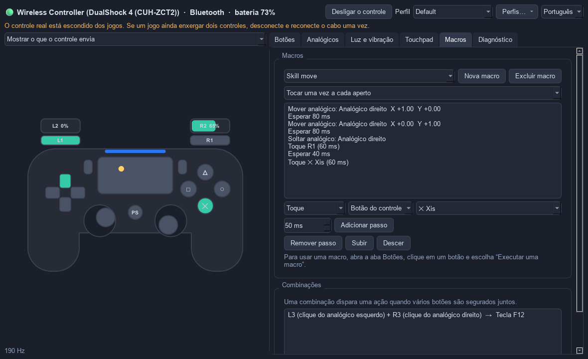
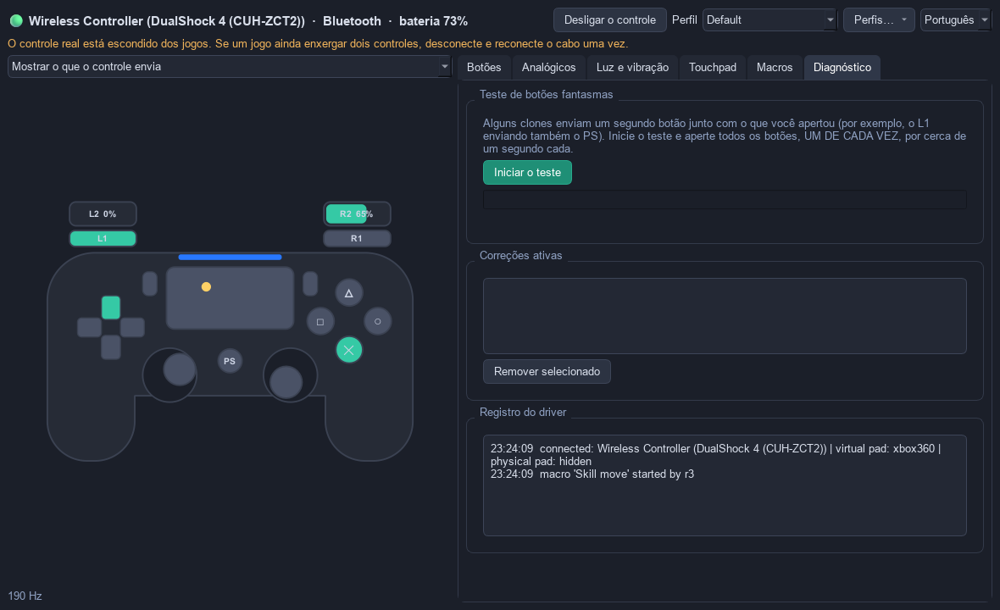

# GambiPad

**Driver e configurador de código aberto para controles no padrão DualShock 4 e seus clones.**
Windows e Linux. Sem software do fabricante.

[English](README.md)



> *Gambiarra*: o conserto esperto que faz funcionar o que não devia.
> É isso que este projeto faz pelos controles genéricos.

## Por quê

Os controles "PS4" genéricos copiam a identidade USB da Sony, mas nem sempre o
firmware. O controle que deu origem a este projeto envia o botão **PS** toda vez
que o **L1** é apertado, e o **clique do touchpad** toda vez que o **R1** é
apertado. No jogo, isso vira captura de tela, lupa e sobreposições disparando
sozinhas, porque a Steam e o Windows acham que você está segurando o PS.

O GambiPad fica entre o controle e os jogos:

```
controle real ──HID──▶ GambiPad ──▶ controle virtual limpo ──▶ jogos
                        │  filtro de botões fantasmas, remapeamento, macros
                        └─▶ barra de luz e vibração de volta ao controle
```

O controle real fica escondido dos jogos, que só enxergam o corrigido.

## Recursos

- **Teste e correção de botões fantasmas**: aperte cada botão uma vez e o GambiPad
  descobre quais arrastam um segundo sinal junto, e passa a filtrá-lo.
- **Detecção de firmware defeituoso**: avisa quando o controle corrompe os próprios
  relatórios (o clone acima repete um byte a cada quatro e perde o eixo horizontal
  do analógico direito) e desativa as entradas que não são confiáveis.
- **Remapeamento** de qualquer botão para outro botão, teclas do teclado ou mouse.
- **Turbo**, **alternar** e **combinações** (vários botões segurados disparam uma ação).
- **Macros**: sequências de apertos, movimentos dos analógicos e pausas, tocadas uma vez, enquanto segura, ou alternadas.
- **Desligar o controle** pela janela ou pela bandeja (Bluetooth).
- **Analógicos**: zona morta, limite externo, curva de resposta, inversão, troca.
  **Gatilhos**: zona morta, curso e gatilho sensível.
- **Barra de luz**: cor fixa, nível da bateria, arco-íris ou desligada.
- **Vibração**: a vibração do jogo é repassada ao controle, com força por motor.
- **Touchpad**: repassar ao jogo, mover o mouse ou virar dois botões extras.
- **Perfis** que você importa, exporta e compartilha (JSON simples).
- Visualização ao vivo do que o controle envia e do que o jogo recebe.
- Interface em português e inglês.

## Capturas de tela

| Analógicos e gatilhos | Barra de luz e vibração |
|---|---|
|  |  |

| Macros e combinações | Teste de botões fantasmas |
|---|---|
|  |  |

As imagens mostram a janela real alimentada por um controle simulado.

## Situação

Versão 0.1: software novo. O que foi testado de verdade:

| | Situação |
|---|---|
| Windows 11, USB e Bluetooth, clone `054C:09CC` | Testado em hardware real |
| Leitura de botões, analógicos, gatilhos e bateria | Testado |
| Detecção e filtro de botões fantasmas | Testado |
| Controle virtual Xbox 360 (ViGEmBus) | Testado |
| Esconder o controle real (HidHide) | Testado |
| Vibração e barra de luz por USB | Testado |
| Controle virtual DualShock 4 | Escrito, pouco testado |
| Bluetooth: leitura, esconder o controle real, desligar | Testado |
| Bluetooth: barra de luz e vibração | Escrito, **não confirmado** |
| Linux (uinput) | Instalador testado automaticamente; driver **ainda não testado em hardware** |

Relatos de outros controles e do Linux são muito bem-vindos: abra uma issue.

## Instalação

### Windows

Baixe o **GambiPad-Setup** na [última versão](https://github.com/agentkyo/gambipad/releases/latest)
e execute. Ele instala só para o seu usuário, sem pedir administrador, e pode iniciar
o GambiPad junto com o Windows. Dois drivers são necessários, e o instalador oferece
abrir as páginas de download quando eles faltam:

- [ViGEmBus](https://github.com/nefarius/ViGEmBus/releases/latest) cria o controle virtual.
- [HidHide](https://github.com/nefarius/HidHide/releases/latest) esconde o controle real dos jogos (reinicie depois de instalar).

O executável não tem assinatura digital, então o SmartScreen pede confirmação na
primeira vez ("Mais informações" e depois "Executar assim mesmo"). Um zip portátil é
publicado ao lado do instalador.

### Linux

```
curl -fsSL https://raw.githubusercontent.com/agentkyo/gambipad/main/install.sh | bash
```

| Distribuição | Como o instalador trata |
|---|---|
| Arch, **CachyOS** | `pacman` para as ferramentas de compilação e bibliotecas do Qt |
| **Ubuntu**, **Zorin OS**, Debian | `apt` |
| **Fedora** | `dnf` |
| **Bazzite**, Silverblue, Kinoite | sistema por imagem: nada é adicionado ao sistema, usa pacotes Python prontos |

O GambiPad vai para um ambiente Python próprio em `~/.local/share/gambipad`, com
entrada no menu e o comando `gambipad` em `~/.local/bin`. O único passo que pede a
sua senha é a regra do udev, que dá ao seu usuário acesso ao controle (hidraw) e ao
`/dev/uinput`. Opções: `--autostart` (inicia com a sessão), `--no-system` (nunca pede
senha), `--uninstall`.

O instalador é executado do zero em imagens Ubuntu, Fedora e Arch a cada mudança.
O GambiPad em si ainda não foi usado com um controle no Linux.

### Com pip (qualquer sistema, Python 3.11+)

```
pip install git+https://github.com/agentkyo/gambipad
gambipad
```

No Windows, o pip pode abrir o instalador do ViGEmBus ao instalar a dependência `vgamepad`.
## Como usar

`gambipad` abre a janela. Ao fechar, ele continua rodando na bandeja do sistema.

1. Conecte o controle.
2. Abra **Diagnóstico → Iniciar o teste** e aperte cada botão, um de cada vez.
3. Se aparecerem botões fantasmas, clique em **Aplicar a correção**.
4. Desconecte e reconecte o controle uma vez, para que os programas que já estavam
   lendo o controle real (a Steam, por exemplo) o soltem.

Linha de comando:

| Comando | O que faz |
|---|---|
| `gambipad` | abre a janela |
| `gambipad run` | roda o driver sem janela |
| `gambipad devices` | lista os controles compatíveis |
| `gambipad monitor` | mostra o que o controle envia |
| `gambipad diagnose --apply` | procura botões fantasmas e salva a correção |
| `gambipad rumble` | testa os dois motores |
| `gambipad off` | desliga um controle Bluetooth |
| `gambipad doctor` | confere os requisitos do sistema |

Os perfis ficam em `%APPDATA%\GambiPad\profiles` (Windows) ou
`~/.config/gambipad/profiles` (Linux). O formato está descrito em
[docs/PROFILE.md](docs/PROFILE.md).

## Vale saber

- **É um driver de kernel?** Não. É um driver em espaço de usuário: lê o controle
  por HID e cria o controle virtual pelo ViGEmBus (Windows) ou pelo uinput (Linux).
  Nada sem assinatura é carregado no kernel.
- **Steam**: com a correção ativa, o controle virtual nunca envia um PS fantasma,
  então os atalhos do botão guia da Steam param de disparar. Não é preciso mexer
  em nenhuma configuração da Steam.
- **O jogo enxerga dois controles**: reconecte o controle uma vez depois de abrir o GambiPad.
- **Meu controle não é detectado**: rode `gambipad devices`. Controles que não usam
  os IDs da Sony podem ser adicionados no `settings.json` como
  `"extra_devices": [[fabricante, produto]]` (números decimais), desde que falem o
  protocolo do DualShock 4.
- **Macros e jogos online**: entrada automatizada pode violar as regras de jogos
  competitivos. Usá-las ali é responsabilidade sua.

## Desenvolvimento

```
git clone https://github.com/agentkyo/gambipad
cd gambipad
python -m venv .venv
.venv/Scripts/pip install -e .[dev]     # Linux: .venv/bin/pip
.venv/Scripts/python -m pytest
```

O protocolo (`ds4.py`) e o motor de mapeamento (`engine.py`) são Python puro, sem
acesso a hardware, então os testes rodam em qualquer lugar.

## Créditos

Feito sobre o [hidapi](https://github.com/libusb/hidapi), o
[ViGEmBus](https://github.com/nefarius/ViGEmBus) e o
[HidHide](https://github.com/nefarius/HidHide) da Nefarius, o
[vgamepad](https://github.com/yannbouteiller/vgamepad), o
[python-evdev](https://github.com/gvalkov/python-evdev) e o
[Qt for Python](https://doc.qt.io/qtforpython/).
Sem vínculo com a Sony. "DualShock" e "PlayStation" são marcas da Sony Interactive
Entertainment.

## Licença

[MIT](LICENSE)
